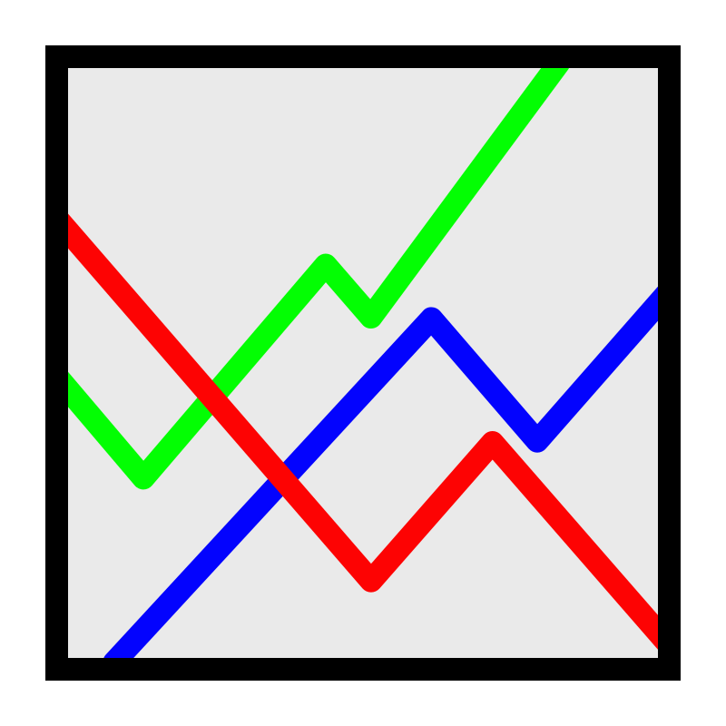

#+TITLE: gnuplot
#+DATE: <2024-12-27 vie>

#+CAPTION: gnuplot's logo
#+ATTR_ORG: :width 250
#+ATTR_HTML: :width 250 :style background: black

|--------+-------------------------------------------------------|
| home   | http://gnuplot.info/                                  |
| faq    | http://gnuplot.info/faq/index.html                    |
| wiki   | https://en.wikipedia.org/wiki/Gnuplot                 |
| wiki   | https://en.wikibooks.org/wiki/Gnuplot                 |
| online | https://hostcat.fhsu.edu/cdclark/static/apps/gnuplot/ |
| source | http://sf.net/p/gnuplot/gnuplot-main/                 |
|--------+-------------------------------------------------------|

- 1986
- Thomas Williams, Colin Kelley
- ~/.gnuplot, gnuplotrc (system-wide)
- .gp extension

* cli

#+begin_src sh
  $ gnuplot [x11 options] [options] [scriptfile ...]
  $ gnuplot -p -e "plot '-'" < rawnumbers # opens qt window
  $ GNUTERM=dumb gnuplot -e 'plot sin(x)'
#+end_src

#+CAPTION: flags
|-----------+----+------------+---------------------------------|
|           |    |    <c>     |                                 |
|           | -e |    CMDS    |                                 |
|           | -c | FILE [ARG] | runs script S with given args   |
| --persist | -p |     -      | keep window after plotting ends |
| --slow    | -s |     -      | wait for slow font init         |
| --default | -d |     -      | do NOT read ~/.gnuplot          |
|-----------+----+------------+---------------------------------|

#+CAPTION: environment variables
|---------+----------------------------------------|
| GNUTERM | terminal override                      |
| FIT_LOG | name of the log file, default: fit.log |
|---------+----------------------------------------|

* language

#+begin_src gnuplot
  #!/usr/bin/gnuplot -persist
  a = 7                       # variable assignent
  f(x,d) = d * x**2           # functions
  f(x)   = (PI=pi, sin(x*PI)) # multi-statement functions
  g(x)   = x <= 0 ? sin(x) : NaN
#+end_src

- NaN type
- {/Symbol ?} - replaces with postscript enhanced symbol http://materials.ucsd.edu/doc/ps_guide.pdf
  - eg: "{/Symbol p}" - replaces parens with 𝛑
- do for [i=1:96] { plot f(x,i*0.1) }
- operators http://www.gnuplot.info/docs_4.2/node55.html
- Colors
  - rgb "#0b0000"
  - rgb "white"

** input data

- space separated by default
- by putting 2 newlines one after another, it separate different *blocks/groups* of data

** functions

- http://web.archive.org/web/20220301182548/http://gnuplot.info/docs_5.5/gnuplot5.html
- http://www.gnuplot.info/docs/loc1283.html
- https://gnuplot.sourceforge.net/docs_4.2/node53.html
- time

*** math

- besj[01], besy[01] - bessel functions, in radians
- trigonometry take radians
  - [a]sin[h]
  - [a]cos[h]
  - [a]tan[2h]
- ceil, int, floor
- abs, sgn
- sqrt, exp, log, log10

|--------------+---------+----------------------------------------------------|
|     <c>      |   <c>   |                                                    |
|    arg(x)    | complex | the phase of x                                     |
|    erf(x)    |   any   | error function of real(x)                          |
|  inverf(x)   |   any   | inverse error function of real(x)                  |
|   erfc(x)    |   any   | 1.0 - error function of real(x)                    |
| ibeta(p,q,x) |   any   | ibeta function of real(p,q,x)                      |
|   gamma(x)   |   any   | gamma function of real(x)                          |
| igamma(a,x)  |   any   | igamma function of real(a,x)                       |
|  lgamma(x)   |   any   | lgamma function of real(x)                         |
|  invnorm(x)  |   any   | inverse normal distribution function of real(x)    |
| lambertw(x)  |  real   | Lambert W function                                 |
|   norm(x)    |   any   | normal distribution (Gaussian) function of real(x) |
|   rand(x)    |   any   | pseudo random number generator                     |
|   real(x)    |   any   | real part of x                                     |
|   imag(x)    | complex | imaginary part of x as a real number               |
|--------------+---------+----------------------------------------------------|

*** string
|--------------------------+------------+-----------------------------------------------------|
|           <c>            |    <c>     |                                                     |
|   gprintf("format",x)    |    any     | string result from applying gnuplot's format parser |
| sprintf("format",x,...)  |  multiple  | string result from C-language sprintf               |
|     strlen("string")     |   string   | int length of string                                |
| strstrt("string","key")  |  strings   | int index of first character of substring "key"     |
| substr("string",beg,end) |  multiple  | string "string"[beg:end]                            |
|    system("command")     |   string   | string containing output stream of shell command    |
|     word("string",n)     | string int | returns the nth word in "string"                    |
|     words("string")      |   string   | returns the number of words in "string"             |
|--------------------------+------------+-----------------------------------------------------|

*** other
|-----------------+---------------+----------------------------------------------------------|
|       <c>       |      <c>      |                                                          |
|    column(x)    |      int      | column 7#7 during datafile manipulation.                 |
|   defined(X)    | variable_name | [DEPRECATED] returns 1 if X is defined, 0 otherwise.     |
|   exists("X")   | variable_name | returns 1 if a variable named X is defined, 0 otherwise. |
| stringcolumn(x) |      int      | content of column 7#7 as a string.                       |
|  timecolumn(x)  |      int      | timecolumn 7#7 during datafile manipulation.             |
|   tm_hour(x)    |      int      | the hour                                                 |
|   tm_mday(x)    |      int      | the day of the month                                     |
|    tm_min(x)    |      int      | the minute                                               |
|    tm_mon(x)    |      int      | the month                                                |
|    tm_sec(x)    |      int      | the second                                               |
|   tm_wday(x)    |      int      | the day of the week                                      |
|   tm_yday(x)    |      int      | the day of the year                                      |
|   tm_year(x)    |      int      | the year                                                 |
|    valid(x)     |      int      | test validity of 48#48 during datafile manip.            |
|-----------------+---------------+----------------------------------------------------------|

** commands

|-----------+------------------------------------+-----------------------------|
|       <r> |                                    |                             |
| multiplot | layout N,N                         |                             |
|           | title S                            |                             |
|           | offset N,N                         |                             |
|     unset | OPTION                             |                             |
|       set | OPTION [VALUE]                     |                             |
|      with | (l)ines[*], dots[.], lines(points) |                             |
|      show | variables                          |                             |
|     stats | FILENAME name S                    | shows file field statistics |
|           |                                    | later can be referenced     |
|           |                                    | eg: S_min_x                 |
|-----------+------------------------------------+-----------------------------|

*** plot

#+begin_src
  [re]plot [XRANGE] [YRANGE] INPUT [PLOT_A OPTS],
           [XRANGE] [YRANGE] INPUT [PLOT_B OPTS]
#+end_src

|--------------+-------------------------|
|     <c>      |                         |
|    INPUT     | reads from...           |
|--------------+-------------------------|
|  "file.txt"  | file contents           |
| "/dev/stdin" | standard input          |
|    "<CMD"    | CMD stdout              |
|      ""      | re-use last given input |
|--------------+-------------------------|

- [[http://gnuplot.info/docs_5.5/loc8595.html][every]] - p++:b++:pstart:bstart:pend:bend
  - N   - every N data points
  - N:N - every N data points, in every other block
- for [VAR = NSTART : NEND]
- for [VAR in LVAR] # LVAR = "30 15 5"
- using N:N+1:N+n
- [[http://www.gnuplot.info/docs/loc9016.html][smooth]]
  - [[http://www.gnuplot.info/docs/loc9099.html][frequency]] - points with the same X-value are replaced with 1 point with Y-values sum
  - [bezier¦mcsplines]
- title S (for legend box)
- bins=N - total N number of bins (NOT SIZE) in graph http://gnuplot.info/docs_6.1/loc9125.html
- binvalue=[avg¦sum] - how to group each bin, default: sum
- index N
  - reference block N of data (aka separated by 2 \n)
  - blocks index start at 0

- with
  - histograms
  - filledcurves
    - [f]ill[s]tyle pattern N
  - dots
  - points
    - pointsize N
  - lines
    - [d]ash[t]ype N¦S
    - [l]ine[t]ype N
    - [l]ine[s]tyle N
    - [l]ine[w]idth N
    - [l]ine[c]olor COLOR
  - linespoint

*** splot
|-------------+------------------------------+-----------------------------------|
| dgrid3d     | N,N                          | ????                              |
| xyplane     | N                            | Z value where xyplane is          |
| +ticslevel+ | N                            | " DEPRECATED                      |
| colorbox    | -                            | color range box                   |
| pm3d        | border lw 1                  | surface with lines                |
| isosamples  | N                            | splot lines draw per xz axis      |
| view        | X,Z                          | 0-180 rotation around axis        |
| contour     | base                         |                                   |
| cntrparam   | levels auto 9                |                                   |
|             | levels discrete 1, -1        |                                   |
|             | levels incremental -2 .05 .2 |                                   |
|             | first 10 sort                |                                   |
| hidden      |                              |                                   |
| hidden3d    | -                            | non translucent (disables sample) |
|             |                              | linestyle 1/2 for top/bottom      |
|             |                              | aka "hidden line removal"         |
|-------------+------------------------------+-----------------------------------|

#+begin_src gnuplot
  splot f(x,y) with pm3d          # surface
  splot f(x,y) lc pal        lw 2 # sets isolines color/thicc
  set     lt 1 lc "seagreen" lw 3
#+end_src

*** fit

1) We come up with a function shape that "fits" our data.
   - the function has 2 types of variables
   - variables that depend on the input (eg: x)
   - variables that we want to find it's value and make "constants" (eg: a)
2) We use =fit= command giving it:
   - the function in 1)
   - the input data
   - the fields *using*
   - the list of variables to find

#+begin_src gnuplot
  f(x) = a*x + b
  fit f(x) "" using 1:2 via a,b
#+end_src

- https://www.youtube.com/watch?v=vHM_5AeKwXE

**** Example output

#+begin_src
gnuplot> fit f(x) "file.txt" using 3:2 via a,b
iter      chisq       delta/lim  lambda   a             b
   0 4.3014300000e+04   0.00e+00  9.71e+00    1.000000e+00   1.000000e+00
   1 7.0509078061e+03  -5.10e+05  9.71e-01    1.315008e+00   6.153986e+00
   2 3.9723792475e+03  -7.75e+04  9.71e-02    9.075167e-01   1.243513e+01
   3 3.9719144040e+03  -1.17e+01  9.71e-03    9.024370e-01   1.251326e+01
   4 3.9719144040e+03  -1.81e-07  9.71e-04    9.024364e-01   1.251327e+01
iter      chisq       delta/lim  lambda   a             b

After 4 iterations the fit converged.
final sum of squares of residuals : 3971.91
rel. change during last iteration : -1.81067e-12

degrees of freedom    (FIT_NDF)                        : 363
rms of residuals      (FIT_STDFIT) = sqrt(WSSR/ndf)    : 3.30786
variance of residuals (reduced chisquare) = WSSR/ndf   : 10.9419

Final set of parameters            Asymptotic Standard Error
=======================            ==========================
a               = 0.902436         +/- 0.02768      (3.067%)
b               = 12.5133          +/- 0.3791       (3.03%)

correlation matrix of the fit parameters:
                a      b
a               1.000
b              -0.890  1.000
#+end_src

*** other
- imagesc - matrix/heatmap - 2d contour
- hist
- scatter3 - 3d points
** options (setteable)

*** misc

#+CAPTION: S ="string", N=number, F=float, P=[0.0-1.0]
|------------+---------------+---------------------------------------------|
|    <c>     |      <c>      |                                             |
|            |               |                                             |
|------------+---------------+---------------------------------------------|
|   table    |  "FILENAME"   | save .dat plot to file, unset it after      |
|  encoding  |     utf8      |                                             |
|------------+---------------+---------------------------------------------|
|   title    |       S       | the                                         |
|   scale    |       N       |                                             |
|   output   |       S       | saves into filepath, unset it after         |
| monochrome |       _       |                                             |
|   object   | [N] rectangle |                                             |
|            | [N] fillstyle |                                             |
|------------+---------------+---------------------------------------------|
|    size    |      P,P      | size in multiplot                           |
|            |    square     |                                             |
|   origin   |      P,P      | position in multiplot, from left and bottom |
|------------+---------------+---------------------------------------------|
|   pause    |       N       | seconds to pause                            |
|  +reread+  |       -       | REMOVED in 6.0 +reread input+               |
|------------+---------------+---------------------------------------------|

**** input parsing

|-------------+-----------------+----------------------------------|
|     <c>     |       <c>       |                                  |
|             |                 |                                  |
|-------------+-----------------+----------------------------------|
|  datafile   |   separator S   |                                  |
|             |  separator tab  |                                  |
|             | separator comma | input separator (default: space) |
|-------------+-----------------+----------------------------------|
| decimalsign |        S        | "." or ","                       |
|   samples   |      N[,N]      | sampling frequency               |
|  [xyz]data  |      time       | tells ? axis is a date/time      |
| timecolumn  |      N FMT      | INPUT format date on column N    |
|   timefmt   |       FMT       | INPUT format date                |
|   format    |    [x¦y] FMT    | OUTPUT format string, eg: %.2f   |
|-------------+-----------------+----------------------------------|

**** axis styling

#+CAPTION: S ="string", N=number, F=float
|---------------+----------------+----------------------------------|
|      <c>      |      <c>       |                                  |
|---------------+----------------+----------------------------------|
| [xyz]zeroaxis |       -        | show zero axes                   |
|    border     |      [N]       | pick axis lines (takes a bitsum) |
|               | linecolor COL  |                                  |
|     grid      |       -        | axis grid                        |
|   logscale    |   [x¦y] [N]    | with step N                      |
|   autoscale   |   [[x¦y]fix]   | prevents autoextend of scale     |
|     xdata     |      time      | tells ? axis is a date/time      |
|    format     |   [x¦y] FMT    | OUTPUT format string             |
| [xyz][2]range |     [N:N]      | axis range                       |
| [xyz][2]tics  |    nomirror    | axis numbers                     |
|               |     rotate     |                                  |
|               | START,STEP,END |                                  |
|               |  (S N[,S N])   | custom labels S at point N       |
|               |   font ",20"   | set font size to 20              |
|   [xyz]tic    |  rotate by N   | rotates tic labels               |
| [xyz][2]label |       S        | axis label                       |
|               |  offset N[,N]  |                                  |
|               |   font ",20"   | set font size to 20              |
|     label     |   N at X,Y S   | puts a label at X,Y position     |
|---------------+----------------+----------------------------------|
*** palette

http://gnuplot.info/demo/pm3dcolors.html

#+begin_src gnuplot
  set palette gray
  set palette rgb 7,5,15
  set palette defined (0 0 0 0, 0.3 1 0 0, 0.6 "blue", 1 "#ffffff")
  set palette defined (0 "blue", 0.5 "red", 1 "white")
  set palette defined (0 "black", 0.5 "blue", 0.5 "red", 1 "white")
  set palette cubehelix start 0 cycles -1. saturation 1
  set palette cubehelix start 1.2 cycles -1 saturation 1
  set palette cubehelix start pi/2 cycles -1 saturation 1
  set palette cubehelix start pi/2 cycles -15 saturation 1
#+end_src

*** key

|-----+---------------+-------------------------------|
|     |      <c>      |                               |
| key |    [BLTR]     | position legend box           |
|     |    [no]box    | enable/disable                |
|     | at graph F, F |                               |
|     |    width N    |                               |
|     |    font S     | use ",14" to change size only |
|     |    at N,N     |                               |
|-----+---------------+-------------------------------|

*** style

|-------+-----------+---------------+----------------------------------|
|       |    <c>    |      <c>      |                                  |
| style |   fill    |  transparent  |                                  |
|       |           |     solid     |                                  |
|       |   solid   |       F       |                                  |
|       | noborder  |       _       |                                  |
|       |   data    |     lines     | sets default for *plot* with ... |
|       |           |  histograms   |                                  |
|       |   line    |       N       | can be later referenced on plot  |
|       | histogram |     gap N     |                                  |
|       |           |    cluster    |                                  |
|       |           |   clustered   |                                  |
|       |           |  rowstacked   |                                  |
|       |           | columnstacked |                                  |
|-------+-----------+---------------+----------------------------------|

#+CAPTION: gnuplot "test" command output
#+ATTR_HTML: :width 500
#+ATTR_ORG: :width 800
[[./test_page.png]]

*** term[inal]

- gif  [animate¦delay N¦loop N]
- webp [animate¦delay N¦loop N]
- png [size¦font]
- pngcairo
- wxt
- xterm (xterm tektronix mode)
- dumb (aka ascii)

* snippets

- mod
  #+begin_src sh
   mod(x, y) = x - y * floor(x / y)
  #+end_src

- stream - draw last 200 lines, ten times per second
  #+begin_src sh
   while (1) {
     plot "< tail -200 plot.dat" using 1:2 with lines
     pause 0.1
   }
  #+end_src

- background fullscreen rectangle
  #+begin_src gnuplot
    set object rectangle \
        from screen 0,0 to screen 1,1 \
        behind \
        fillcolor rgb '$background' \
        fillstyle solid \
        noborder
  #+end_src

* examples

- map https://gnuplotting.org/plotting-the-world-revisited/index.html
  - [[https://gnuplotting.org/data/world_10m.txt][world_10m.txt]]
  - [[https://gnuplotting.org/data/world_50m.txt][world_50m.txt]]
  - [[https://gnuplotting.org/data/world_110m.txt][world_110m.txt]]

- https://github.com/TheFox/gnuplot-examples
- https://gnuplot.info/screenshots/index.html
- https://gnuplot.sourceforge.net/demo_5.4/

* tools

- emacs: [[https://orgmode.org/worg/org-contrib/babel/languages/ob-doc-gnuplot.html][Org-babel-gnuplot]]
- color theming https://github.com/GideonWolfe/Gnuplot-Pywal
- wrapper: [[https://github.com/dkogan/feedgnuplot][feedgnuplot]] - realtime and stored data from the cli
- config https://github.com/Gnuplotting/gnuplot-configs
- pallettes
  - https://github.com/Gnuplotting/gnuplot-palettes
  - https://github.com/aschn/gnuplot-colorbrewer

* gotchas

- by default wants *space* separated fields
- sizes are given in pixels, can be undesired when exporting at large dimensions
- plot field indexing starts at $1
- poor compiler messages
- different compiler messages when reading a script or from *-e*
- no *%a* date format for input parsing
- to read from stdin "-" might not work in plot (?
  - use /dev/stdin
- you cannot plot fields from differents files/inputs against each other
- on multiplot, sometimes a plot will silently fail (?
